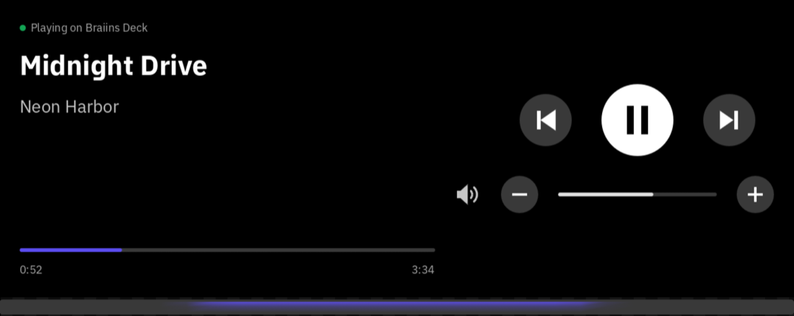

# AirPlay Remote for the Braiins Deck

Play music from your iPhone on the Braiins Deck's speaker, and control it from the Deck's screen.



- **The Deck becomes an AirPlay speaker.** It shows up as **Braiins Deck** in your iPhone's AirPlay
  menu, so anything that plays audio can play through it: YouTube in Brave (whose Shields block the
  ads), Spotify, Apple Music, podcasts.
- **The AirPlay Remote widget** shows the song, artist and progress. Its play/pause, previous/next
  and volume buttons control the iPhone.
- **Pausing is instant.** The Deck goes quiet the moment you pause, instead of playing out the
  couple of seconds of music it has buffered.
- **The light strip glows while music plays**, steady or pulsing in a colour you pick. It turns
  off when the music stops, whichever scene is showing.

## What you need

- A Braiins Deck whose firmware runs **widget SDK 0.6**. Check with the command below; it should
  print `widget SDK version 0.6.0`. The Deck shows its IP when you swipe down on its screen.

  ```bash
  ssh root@<deck-ip> "grep -m1 -o 'widget SDK version [0-9.]*' /var/log/bmc/run-bmc-wasm-host-sdk-v0.log"
  ```

- Root SSH login to the Deck with a key. If you can log in with a password, set that up once with
  `ssh-copy-id root@<deck-ip>`.
- A Mac or Linux computer with git, [Git LFS](https://git-lfs.com), [Rust](https://rustup.rs) and
  python3. The pinned Rust version installs itself on the first build.
- An iPhone (or iPad or Mac) on the same Wi-Fi as the Deck.

## Install

```bash
git lfs install
git clone --recurse-submodules https://github.com/elliotalderson95/braiins-deck-airplay-remote.git
cd braiins-deck-airplay-remote
deck/install.sh <deck-ip>          # the AirPlay speaker
deck/install-remote.sh <deck-ip>   # the bridge the widget reads
./deploy.sh <deck-ip>              # builds and installs the widget
```

Then add **AirPlay Remote** to a scene in the Deck's web interface. The first `./deploy.sh` takes a
few minutes, as it builds the widget and the SDK's packaging tool. All three scripts are safe to
re-run, for example after a Deck firmware update removes what they installed.

## Play music

1. Start something on your iPhone, for example YouTube in Brave.
2. Open Control Center, tap the AirPlay icon on the music card, and pick **Braiins Deck**.

The widget then follows what's playing, and its buttons act on the iPhone. The iPhone's own volume
buttons set the Deck's volume too. In the widget's settings you can choose what the light does while
music plays (steady, slow pulse or off) and its colour.

## How it works

```text
          AirPlay audio                                  mute switch
 iPhone ────────────────▶ shairport-sync ──▶ ALSA "airplay" ──▶ speaker
   ▲                            │ song info
   │ button presses (DACP)      ▼
   │                        bridge.lua ──▶ state.json ──▶ CGI (Deck only)
   │                                                          │
   └─────────────────────── AirPlay Remote widget ◀───────────┘
```

- **`deck/install.sh`** installs [shairport-sync](https://github.com/mikebrady/shairport-sync)
  3.3.9, the standard open-source AirPlay receiver, from OpenWrt 22.03.4's official packages. That
  is the release and CPU architecture the Deck's firmware is built on. Each package's SHA-256 is
  checked before it is installed.
- **`deck/install-remote.sh`** adds `bridge.lua`, which follows shairport-sync's metadata: song,
  artist, progress, volume, play state, and the iPhone's remote-control ID and token. The bridge
  writes these as JSON. A CGI on the Deck's web server serves that JSON to the Deck itself only,
  because the token lets whoever holds it control the iPhone.
- **The widget** reads that every second. It finds the iPhone's remote-control service
  (`_dacp._tcp`) over mDNS and sends it the button presses.
- **Instant pause.** An iPhone keeps streaming (silence) through a pause, and the Deck still holds
  about 2 s of music by then. So on pause, the widget and the bridge switch off AirPlay's own ALSA
  mute switch (`deck/alsa-airplay.conf`), which silences it within about 0.1 s. It comes back on
  when you press play, or on its own after 4 s. The Deck's own "Speaker" switch can't do this,
  because its amplifier only checks that switch when a sound starts.

## Known limits

- Music starts about 2 s after you press play. That is AirPlay's fixed delay, and it is what keeps
  the sound in step with the video on your iPhone.
- It plays in mono, since the Deck has one speaker.
- Alarms can't sound while AirPlay is playing, because only one program can use the Deck's speaker
  at a time.
- Anyone on your Wi-Fi can play to it. To require a password, set `password = "…";` in the `general`
  section of `deck/shairport-sync.conf` and re-run `deck/install.sh`.
- The widget is built for widget SDK 0.6. Firmware with a newer SDK needs it ported.
- If something doesn't work, check the receiver's log with
  `ssh root@<deck-ip> 'logread | grep shairport'`.

## Uninstall

```bash
./undeploy.sh <deck-ip>
deck/uninstall-remote.sh <deck-ip>
deck/uninstall.sh <deck-ip>
```

## What's on the Deck

| Path                                   | What                                                                 |
| -------------------------------------- | -------------------------------------------------------------------- |
| `/etc/shairport-sync.conf`             | The receiver's config, a copy of `deck/shairport-sync.conf`          |
| `/etc/shairport-sync.conf.orig`        | The package's original sample config                                 |
| `/etc/config/shairport-sync`           | Starts the receiver at boot                                          |
| `/etc/alsa/conf.d/50-airplay.conf`     | AirPlay's sound output with its own mute switch                      |
| `/etc/hotplug.d/iface/99-deck-airplay` | Re-announces the speaker whenever the Wi-Fi reconnects               |
| `/usr/share/airplay-remote/`           | The bridge (`bridge.lua`) and the pause mute (`hush`)                |
| `/etc/init.d/airplay-remote`           | Starts the bridge at boot                                            |
| `/www/cgi-bin/airplay-remote`          | Serves the bridge's state to the widget, on the Deck only            |
| `widget-airplay-remote` package        | The widget, added with the Deck's own package manager (`bmc-nix-cli`) |

## Develop

The widget is Rust compiled to WebAssembly, built against the Braiins Deck SDK in `bmc-sdk/`. That
is a submodule of [BraiinsForge/bmc-main](https://github.com/BraiinsForge/bmc-main), pinned to the
SDK 0.6 commit. The state and layout logic have tests:

```bash
cargo test -p airplay-remote
```

To try the widget on a Mac without a Deck or an iPhone, run it in the SDK's testbed. Two stand-ins
play the parts of the bridge and an iPhone:

```bash
cargo build --manifest-path bmc-sdk/Cargo.toml -p bmc-wasm-runtime --features testbed --bin testbed
cargo build -p airplay-remote --target wasm32-unknown-unknown
tools/mock-airplay.py &
dns-sd -P iTunes_Ctrl_0123456789ABCDEF _dacp._tcp local 8766 mock-iphone.local 127.0.0.1 &
bmc-sdk/target/debug/testbed --manifest airplay-remote/manifest.json \
  --rewrite-url http://127.0.0.1:8000=http://127.0.0.1:8766 \
  target/wasm32-unknown-unknown/debug/airplay_remote.wasm
```

After changing the widget, bump `version` in both `airplay-remote/manifest.json` and
`airplay-remote/Cargo.toml`, then run `./deploy.sh <deck-ip>`. The Deck restarts the widget with
the new version.

## License

GPL-3.0-or-later; see [COPYING](COPYING). The widget is built with the Braiins Deck SDK, which is
GPL-3.0-or-later. shairport-sync and its libraries are downloaded from OpenWrt at install time, under
their own licenses.

This is an independent project, not made or endorsed by Braiins.
